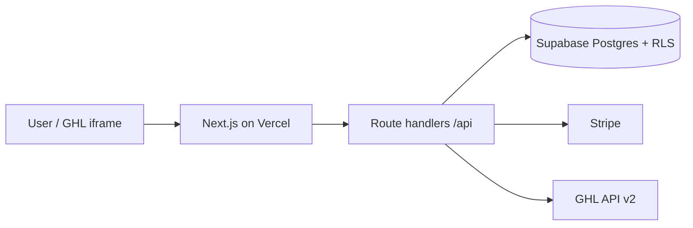
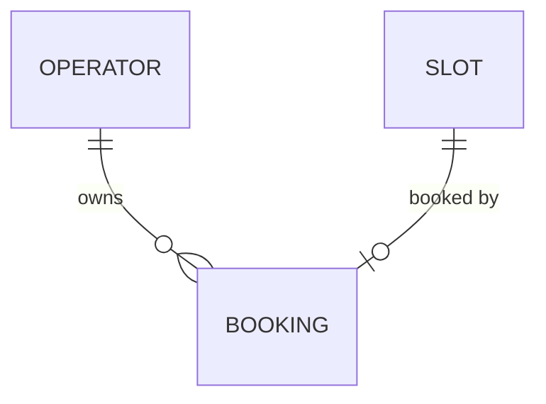

# Architecture: <Product>

**Status:** proposed (locked at Gate 2) · **Decisions:** `docs/decisions/` · **Security model:** `docs/SECURITY_MODEL.md` · **Contract:** `docs/openapi.yaml`

## Summary
<3–5 sentences: what the system is, the house stack (or deviations → decision NNNN), how it's deployed, how it connects to GHL / Stripe / other systems.>

## System diagram

## Modules
| Module | Responsibility | Lives in | Lane |
|---|---|---|---|
| <bookings> | <create, list, cancel bookings; slot conflicts> | `src/lib/server/services/bookings.ts`, `src/app/api/bookings/` | backend |
| <booking UI> | <slot picker, booking list> | `src/app/(app)/bookings/`, `src/components/bookings/` | frontend |

## Data model

Key queries and their indexes: <query → index>

## Direct Supabase access (no API route)
| Table | Operations | Why RLS alone is enough |
|---|---|---|
| <none / table> | <select> | <…> |

## Stories served without the API
| Story | Why |
|---|---|
| <none / US-NNN> | <static content / client-only> |

## Lane ownership (copied into build steps)
- **Backend:** `src/proxy.ts` (Next 16 session refresh + redirects), `src/app/api/**`, `src/lib/server/**` (services, integrations, auth, http, log, env, admin), `supabase/seed.sql`, `tests/api/**`, `tests/helpers/**`
- **Integration (only when `bl-integration` is dispatched; otherwise these stay with Backend):** `src/lib/server/integrations/**`, `src/app/api/webhooks/**`, `src/lib/server/jobs/sync-*`, `tests/integrations/**`, `tests/mocks/**`, `docs/integrations/**`
- **Frontend:** `src/lib/utils.ts`, `src/app/(app)/**`, `src/app/embed/**`, `src/components/**`, `src/hooks/**`, `src/lib/api/fetcher.ts`, `src/mocks/**`
- **Architect (contract — changes via contract question):** `docs/openapi.yaml`, `supabase/migrations/**`, `orval.config.ts`, `src/lib/shared/**`, generated `src/lib/api/generated/**` + `src/types/database.ts`
- **Designer (generated):** `src/app/theme.css`
- **QA:** `tests/e2e/**`, `tests/fuzz/**`, `playwright.config.ts`, `docs/test-plan.md`, `docs/qa-reports/**`
- **Security:** `.opengrep/**`, `.gitleaks.toml`, `scripts/security-scan.sh`
- **DevOps:** `.github/**`, `vercel.json`, `infra/**`, `scripts/install-scanners.sh`, `scripts/env-check.mjs`, `scripts/smoke.mjs`, `.env.example`, `docs/runbook.md`, `docs/deployments/**`

## Environment variables (names only — values are set by Matthew)
| Name | Used by | Server-only? |
|---|---|---|
| `NEXT_PUBLIC_SUPABASE_URL` | client + server | no |
| `NEXT_PUBLIC_SUPABASE_ANON_KEY` | client + server | no |
| `SUPABASE_SERVICE_ROLE_KEY` | `src/lib/server/admin.ts` only | **yes** |

## Capacity & reliability
| Concern | Expected (from PRD) | Plan |
|---|---|---|
| Volume | <rows/yr, requests/day> | <indexes, pagination> |
| Slow work | <e.g. sync to GHL> | <inline under 10 s / queued> |
| Failure of <third party> | <…> | <retry with backoff, user-visible state> |

## Observability
- Health: `GET /api/health`
- Logs: structured (`level`, `route`, `operator_id`, `request_id`; never secrets or personal data)
- Errors: <Vercel logs (default) / Sentry (spend gate)>
- Analytics events: per `docs/metrics-spec.md`, destination <…>
