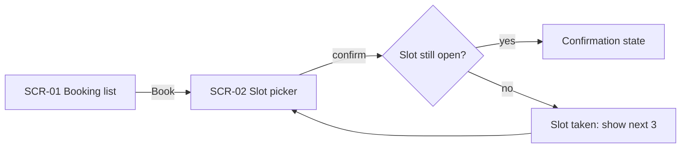

# Designer · Flows & Information Architecture

Screens come from stories, not from imagination. Before drawing anything, map every story to where it happens and how the user gets there. All of it goes in `docs/user-flows.md` (template: `templates/user-flows.md`) — the architect reads this file for data needs.

## 1. Screen inventory

From `docs/user-stories.md`, list every screen (and significant modal/drawer) the Must and Should stories need:

| ID | Screen | Stories | Entry points | Access | Conversion | Data needs (for the architect) |
|---|---|---|---|---|---|---|
| SCR-01 | Booking list | US-002 | nav "Bookings", after booking | signed-in | no | my bookings: date, slot, status; paginated, newest first |
| SCR-02 | Slot picker | US-003 | SCR-01 "Book", GHL embed | embed | yes | open slots for a date range; clinic name |

Rules:
- IDs are `SCR-NN`, stable, never reused.
- **Every Must story appears in at least one screen's Stories column.** (The checker enforces it.)
- **Data needs** are written in plain terms — what's shown, filtered, sorted, how much. They're the architect's input for tables and endpoints; never name tables or endpoints yourself.
- Merge screens that serve the same job; one screen with one primary purpose.

## 2. Navigation

- Primary navigation ≤ 5 top-level items; group the rest.
- Name things in the user's words (from the PRD personas), not the system's.
- **GHL embed routes have no app chrome** — no top nav, no sidebar; they're one focused task inside the client's GHL page (see `ux-a11y` §4).
- Mark which screens are signed-in, public, or embed-only.

## 3. Flows

For each Must story, a Mermaid flow in `docs/user-flows.md`:

Every flow includes the edge and error paths from the story's `[edge]` and `[error]` criteria — slot taken, session expired, payment declined, offline — not just the happy path. Note where the user can go back, and what's preserved when they do.

## 4. Cognitive load

- One primary action per view; secondary actions visibly subordinate.
- Forms: ≤ ~4 fields per group; long forms chunked into steps with progress.
- Choices per decision kept small (Hick's law); defaults pre-selected when the PRD says one option is common.
- Familiar patterns over novel ones (Jakob's law) — the client's customers use other apps all day.

## 5. Exit condition

Every Must story maps to a screen; every screen has an ID, entry points, data needs and a purpose; every Must story has a flow with its edge paths.

---
Sources (ideas adapted, text written for Baseleap): owl-listener/designer-skills `information-architecture`, `navigation-patterns`, `hicks-law`, `jakobs-law`, `millers-law` (MIT), buildgreatproducts/builder-os `design-better` (MIT — Laws of UX, cognitive load), product-on-purpose/pm-skills `discover-customer-journey-map` (Apache-2.0). ulpi-io/skills user-flow template reviewed for ideas only (no licence).
