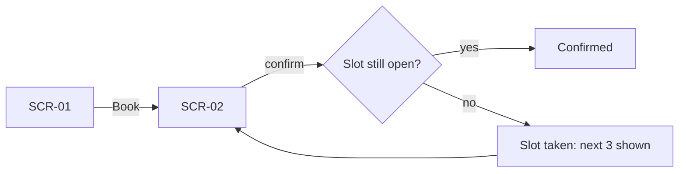

# User Flows: <Product>

**Status:** proposed (locked at Gate 2) · **Read by:** bl-architect (data needs), bl-frontend, bl-qa · **Visual spec:** `docs/design-specs.md`

## Screen inventory
| ID | Screen | Stories | Entry points | Access | Conversion | Data needs (for the architect) |
|---|---|---|---|---|---|---|
| SCR-01 | <Booking list> | US-002 | nav "Bookings" | signed-in | no | <my bookings: date, slot, status; newest first; paginated> |
| SCR-02 | <Slot picker> | US-003 | SCR-01 "Book", GHL embed | embed | yes | <open slots for a date range; clinic name> |

## Navigation
<primary nav items (≤ 5), what's signed-in / public / embed-only>

## Flows
### US-003 — <Patient books a slot>

## Edge paths not shown in a flow
| Situation | What happens | AC |
|---|---|---|
| <session expires mid-booking> | <sign in again, selection kept> | AC-003.4 |
