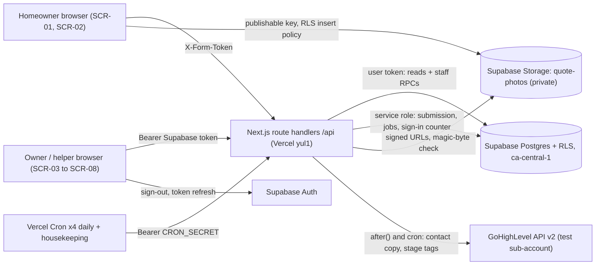
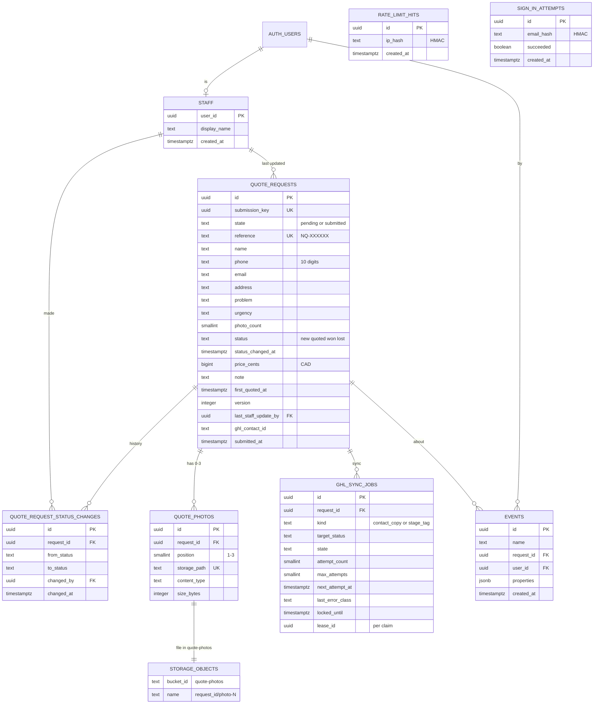

# Architecture: Northside quote requests

**Status:** proposed (locked at Gate 2), revised after the S0 threat model (Pass 2, `.baseleap/reviews/S0.md`) · **Decisions:** `docs/decisions/` (0001 to 0004) · **Security model:** `docs/SECURITY_MODEL.md` · **Contract:** `docs/openapi.yaml` · **Integration contract:** `docs/integration-contract.md`

## Summary
One Next.js (App Router, TypeScript strict) app on Vercel (`yul1`), backed by one Supabase project per environment in ca-central-1 (Postgres with RLS on every table, Auth for the two staff, a private Storage bucket for photos). It is the house stack with no deviations (decision 0001). Homeowners submit through a public page in two calls with photos uploaded straight to Storage (decision 0002); the owner and helper sign in through our server and work the inbox as a list or a four-column board, with every write going through a database function that checks a 7-day staff session and a version number (decision 0003). Each stored request and each status change queues a one-way GoHighLevel sync job that runs right after the response and is retried by four daily Vercel Cron runs, which fits the Hobby plan at $0 (decision 0004). Build mode is hybrid: our app is the system of record and GHL only receives a contact copy and stage tags.

## System diagram


### Submission sequence (decision 0002)
```mermaid
sequenceDiagram
  participant B as Homeowner browser
  participant A as /api
  participant S as Supabase Storage
  participant D as Postgres
  B->>A: GET / (rendered per request, Cache-Control private no-store, fresh token)
  B->>A: POST /quote-requests (X-Form-Token, fields, photo plan)
  A->>A: token >= 3 s, honeypot empty, validate
  A->>D: start_quote_request(): lock on the nonce, replay or rate-limit slot + insert pending (one call, service role)
  A-->>B: 201 request_id + upload paths (200 replay, 409 form_already_used, 429)
  B->>S: upload photo-1..n (publishable key; RLS: own pending folder, max 3)
  B->>A: POST /quote-requests/{id}/submission (same token)
  A->>S: list + read first bytes, size (service role)
  A->>D: complete_quote_request(): photos, NQ- reference, copy job, event (one transaction)
  A-->>B: 200 reference (SCR-02)
  A->>A: after(): first GHL copy attempt
```

## Modules
| Module | Responsibility | Lives in | Lane |
|---|---|---|---|
| Env | the only reader of `APP_SIGNING_SECRET` and `CRON_SECRET`; lazily validated, refuses values under 32 characters (SECURITY_MODEL invariant 15) | `src/lib/server/env.ts` | backend |
| Form token | issue and verify `X-Form-Token` (HMAC, 3 s to 24 h); throws when the signing secret is missing or short | `src/lib/server/form-token.ts` | backend |
| Submissions | token, honeypot and zod checks, then one `start_quote_request()` call (one request per token, atomic rate limit with the address hashed per SECURITY_MODEL "Network address"), clear a pending request's uploads on `updated`, photo magic-byte, size and dimension check, call `complete_quote_request`, schedule the first GHL attempt | `src/lib/server/services/submissions.ts`, `src/app/api/quote-requests/route.ts` (POST), `src/app/api/quote-requests/[request_id]/submission/route.ts` | backend |
| Inbox reads | list (cursor, status, search) through the `list_quote_requests` RPC only, never a PostgREST filter string; detail (signed photo URLs, GHL state mapping, last updated), photos refresh, weekly count, staff me | `src/lib/server/services/quote-requests.ts`, `src/app/api/quote-requests/route.ts` (GET), `src/app/api/quote-requests/[request_id]/route.ts`, `.../photos/route.ts`, `src/app/api/weekly-counts/current/route.ts`, `src/app/api/staff/me/route.ts` | backend |
| Inbox writes | price and note, status change (RPCs), schedule the stage-tag attempt | `src/lib/server/services/quote-requests.ts`, `.../quote/route.ts`, `.../status-changes/route.ts` | backend |
| Auth | sign-in with the per-email pause (`take_sign_in_attempt` before Supabase Auth, `mark_sign_in_succeeded` after a staff sign-in), route auth helper (`requireStaff`), session refresh, page redirects, per-request CSP nonce | `src/lib/server/auth/**`, `src/app/api/auth/sign-in/route.ts`, `src/proxy.ts` | backend |
| HTTP plumbing | wraps every route handler: problem+json responses, PostgREST error mapping (`PT401` → 401, `PT404` → 404, `PT409` → 409, `PT422` → 422, `23514` → 422 with our own field messages, `23505` on `submission_key` → the replay), catches unhandled errors and logs `{ error_class, code }` only (never `message`, `details`, `hint` or the error object), 405 handlers, security headers | `src/lib/server/http.ts`, `next.config.*` headers (A2 scaffolds) | backend |
| Events and logs | write `events` rows (ids only), structured JSON logs with an allow-list of fields (Observability) | `src/lib/server/events.ts`, `src/lib/server/log.ts` | backend |
| Housekeeping | purge stale pending requests and their files, counters older than 24 h | `src/lib/server/jobs/housekeeping.ts`, `src/app/api/jobs/housekeeping/route.ts` | backend |
| GHL client and runner | GHL HTTP client (token, version, timeout, error classes, production base URL fixed), contact copy, stage tags, claim one job per lease and settle it with that lease, contact id check, manual retry | `src/lib/server/integrations/ghl/**`, `src/lib/server/jobs/ghl-sync.ts`, `src/app/api/jobs/ghl-sync/route.ts`, `src/app/api/quote-requests/[request_id]/ghl-copy-retries/route.ts` | integration |
| Public pages | SCR-01 form, rendered per request (`await connection()` before `issueFormToken()`, `Cache-Control: private, no-store`); a fresh token after every completed submission; photo picker and direct upload; SCR-02 (reference kept in `sessionStorage` for reloads in the same tab). See "Build requirements from S0" | `src/app/(public)/page.tsx`, `src/app/(public)/request-sent/page.tsx`, `src/components/request/**` | frontend |
| Staff pages | SCR-03 sign-in, SCR-04 list, SCR-05 board (drag plus Move to), SCR-06 detail, SCR-07 strip, SCR-08 viewer | `src/app/(public)/sign-in/page.tsx`, `src/app/(staff)/inbox/**`, `src/components/inbox/**` | frontend |
| API client | Orval-generated fetchers, TanStack Query hooks, Zod schemas, MSW mocks; one hand-written fetcher | `src/lib/api/generated/**` (generated), `src/lib/api/fetcher.ts` | architect (generated) / frontend (fetcher) |

**Integration seam.** `src/lib/server/integrations/ghl/index.ts` exports `runGhlJobs(options: { requestId?: string; limit?: number }): Promise<JobRunResult>`. Backend routes call it inside `after()` after a submission completes and after a real status change; the cron route calls it with no `requestId`. A2 scaffolds it as a no-op stub returning zero counts so the backend lane never waits on the integration lane.

**GHL state shown on SCR-06** (backend maps job rows to the contract's `ghl` object):
- `copy`: job `succeeded` → `copied` (at = `last_attempt_at`); `pending` or `waiting` → `waiting` (at = `last_attempt_at`); `failed` → `failed` (at = `last_attempt_at`).
- `stage_tag`: the newest non-superseded `stage_tag` job decides (`succeeded` → `up_to_date`, `pending`/`waiting` → `waiting`, `failed` → `failed`). With no such job, it follows the copy (`copied` → `up_to_date`, `waiting` → `waiting`, `failed` → `failed`), because the contact is created with the current stage tag.

### Routes and screens
| Screen | Route | Operations |
|---|---|---|
| SCR-01 Request a quote | `/` | `createQuoteRequest`, `uploadQuotePhoto` (supabase-js), `submitQuoteRequest` |
| SCR-02 Request sent | `/request-sent` (reads `sessionStorage`; without it, redirects to `/`) | none |
| SCR-03 Staff sign-in | `/sign-in` | `signIn`; sign-out with `supabase.auth.signOut()` |
| SCR-04 Inbox, List | `/inbox` (default view) | `listQuoteRequests` (status, q), `changeQuoteRequestStatus`, `getCurrentWeeklyCount`, `getCurrentStaff` |
| SCR-05 Inbox, Board | `/inbox?view=board` | `listQuoteRequests` once per column (status = new, quoted, won, lost), `changeQuoteRequestStatus`, `getCurrentWeeklyCount` |
| SCR-06 Request detail | `/inbox/[request_id]` ("Back to Inbox" restores view, filter and scroll from client state) | `getQuoteRequest`, `saveQuote`, `changeQuoteRequestStatus`, `retryGhlCopy` (Could) |
| SCR-07 Weekly count | strip on SCR-04 and SCR-05 | `getCurrentWeeklyCount` (refetched after every successful status change) |
| SCR-08 Photo viewer | dialog on SCR-06 | `listQuoteRequestPhotos` when opened and when a URL is near expiry |

## Data model


Migrations: `supabase/migrations/20261120000100_extensions_and_helpers.sql` (pgcrypto, `app_private`), `..0200_staff.sql`, `..0300_quote_requests.sql`, `..0400_ghl_sync.sql`, `..0500_events_and_limits.sql`, `..0600_functions.sql` (RPCs and server functions), `..0700_storage.sql` (bucket and `storage.objects` policies). Every table has RLS enabled **and forced**, with explicit grants. Tests: `supabase/tests/rls/*.sql` (one per table, storage, and `all_tables.sql` for catalog-wide rules and the BYPASSRLS check) and `supabase/tests/functions/*.sql`. pgTAP is not in any migration: each test file installs it inside its own transaction, so it never reaches production (S0 SEC-18).

`on delete` choices: photos, history, jobs and events **cascade** from `quote_requests` (a by-hand privacy deletion removes everything about the request); staff references **set null** (history survives a removed account); `staff.user_id` **cascades** from `auth.users`.

Key queries and their indexes:
| Query (screen, story) | Index |
|---|---|
| Inbox list newest first, 50 per page, keyset cursor (SCR-04, US-005), through `list_quote_requests` | `quote_requests_inbox_idx (submitted_at desc, id desc) where state = 'submitted'` |
| List filtered by status, and each board column (SCR-04, SCR-05, US-011, US-016), through `list_quote_requests` | `quote_requests_status_inbox_idx (status, submitted_at desc, id desc) where state = 'submitted'` |
| Requests this week (SCR-07, US-008) | `quote_requests_inbox_idx` (range on `submitted_at`) |
| Won / Lost this week (SCR-07, US-008) | `quote_requests_status_changed_idx (status, status_changed_at) where state = 'submitted'` |
| Request by id (SCR-06) | primary key |
| Replay of a form token (US-001), in `start_quote_request` | unique `submission_key` |
| Photos of a request in order (SCR-06, SCR-08) | unique `(request_id, position)` |
| Staff photo read policy: is this object recorded? (SCR-06, SCR-08) | unique `quote_photos.storage_path` |
| Copy job and latest stage-tag job of a request (SCR-06) | `ghl_sync_jobs_request_idx (request_id, kind, created_at desc)` |
| Due sync jobs, one per claim (runner, `claim_ghl_job`) | `ghl_sync_jobs_due_idx (next_attempt_at) where state in ('pending','waiting')` |
| Accepted submissions per address, last 10 min (US-003), in `take_submission_slot` | `rate_limit_hits_ip_created_idx (ip_hash, created_at desc)` |
| Failed sign-ins per email, last 15 min (US-004), in `take_sign_in_attempt` | `sign_in_attempts_email_created_idx (email_hash, created_at desc)` |
| Stale pending purge (housekeeping) | `quote_requests_pending_created_idx (created_at) where state = 'pending'` |
| Metrics by event and window | `events_name_created_idx (name, created_at)` |
| Search by reference, name, phone (US-013, Could), through `list_quote_requests` | none on purpose: about 2,400 rows a year, a filtered scan is milliseconds |

## Direct Supabase access (no API route)
| Table | Operations | Why RLS alone is enough |
|---|---|---|
| none (no `public` table) | none | every table read and write goes through `/api` |
| Storage `quote-photos` (anon) | insert into `{request_id}/photo-N` | the insert policy enforces own pending folder, planned position, 60-minute window and at most 3; the server re-checks the bytes before completing |
| Supabase Auth (staff) | sign-out, token refresh | no data; handled by `@supabase/ssr` |

## Stories served without the API
| Story | Why |
|---|---|
| US-004 (part) | Sign-out and access-token refresh use the Supabase Auth client (`supabase.auth.signOut()`, `@supabase/ssr`), and signed-out page visits are redirected to `/sign-in` by `src/proxy.ts`; sign-in itself is `signIn` and the staff check is `getCurrentStaff`. |
| US-002 (part) | The photo bytes go straight to Supabase Storage (`uploadQuotePhoto` documents it, but Supabase implements it), because Vercel functions refuse bodies over 4.5 MB. |
| US-001 (part) | SCR-02 surviving a reload in the same tab is client state (`sessionStorage`), per the designer's ruling; there is no lookup endpoint (NG-3). |
| US-016 (part) | Dragging, the "Saving" state, the revert on failure and the screen-reader message are client-only; the move itself is `changeQuoteRequestStatus`. |

## Lane ownership (copied into build steps)
- **Backend:** `src/proxy.ts`, `src/app/api/**` except `src/app/api/jobs/ghl-sync/**` and `src/app/api/quote-requests/[request_id]/ghl-copy-retries/**`; `src/lib/server/**` except `src/lib/server/integrations/**` and `src/lib/server/jobs/ghl-sync.ts` (services, auth, form token, http, log, env, events, housekeeping; `src/lib/server/admin.ts` is created by A2 and edited only by backend); `supabase/seed.sql`; `tests/api/**`; `tests/helpers/**`
- **Integration:** `src/lib/server/integrations/**` (GHL client, contact copy, stage tags, runner, `index.ts` seam), `src/lib/server/jobs/ghl-sync.ts`, `src/app/api/jobs/ghl-sync/**`, `src/app/api/quote-requests/[request_id]/ghl-copy-retries/**`, `tests/integrations/**`, `tests/mocks/**` (GHL stub server), `docs/integrations/**`
- **Frontend:** `src/app/(public)/**`, `src/app/(staff)/**`, `src/components/**`, `src/hooks/**`, `src/lib/api/fetcher.ts`, `src/lib/supabase/browser.ts` (sessionless client for uploads, session client for auth), `src/lib/utils.ts`, `src/mocks/**`
- **DevOps:** `.github/**`, `vercel.json` (the four `ghl-sync` cron entries at `0 0 * * *`, `0 6 * * *`, `0 12 * * *`, `0 18 * * *` and one `housekeeping` entry at `30 7 * * *`, all UTC; function region `yul1`), `infra/**`, `scripts/install-scanners.sh`, `scripts/env-check.mjs`, `scripts/smoke.mjs`, `.env.example`, `docs/runbook.md`, `docs/deployments/**`
- **Architect (contract; changes through a contract question):** `docs/openapi.yaml`, `docs/integration-contract.md`, `supabase/migrations/**`, `supabase/tests/**`, `orval.config.ts`, `src/lib/shared/**`, generated `src/lib/api/generated/**` and `src/types/database.ts`; scaffold-only files from A2: `src/app/layout.tsx`, `src/app/globals.css`, `next.config.*`, `package.json`
- **Designer (generated):** `src/app/theme.css`
- **QA:** `tests/e2e/**`, `tests/fuzz/**`, `playwright.config.ts`, `docs/test-plan.md`, `docs/qa-reports/**`
- **Security:** `.opengrep/**`, `.gitleaks.toml`, `scripts/security-scan.sh`

Orval note for A2: generate from `docs/openapi.yaml` excluding the `Photo storage` tag (`uploadQuotePhoto` is implemented by Supabase and called through supabase-js).

### Build requirements from S0 (copied into build steps)
Each line is a requirement on that lane's step, with the SECURITY_MODEL invariant or section that states it and the check that proves it.
- **Frontend (SEC-2):** `src/app/(public)/page.tsx` calls `await connection()` from `next/server` before `issueFormToken()`; the page is never static, ISR or CDN-cached. After `submitQuoteRequest` succeeds, or `createQuoteRequest` returns 200 with `submission_state: submitted`, the page drops its token and calls `router.refresh()` before another submission is allowed. The nonce of each completed submission goes into `sessionStorage`; on mount and on `pageshow` a page whose token is listed refreshes first. On 409 `form_already_used` or 400 `form_expired`, refresh the token, keep every typed value, and let the homeowner send again. (SECURITY_MODEL "The public formToken scheme".)
- **Frontend (SEC-16):** show staff photos with a plain ``, never `next/image` remote optimisation. (Invariant 7.)
- **A2 scaffold (SEC-2, SEC-15):** no `export const dynamic = 'force-static'`, `revalidate` or `"use cache"` on `/` or the root layout. `next.config.*` `headers()` sends `Cache-Control: private, no-store` on `/` explicitly (Next.js fixes `Cache-Control` only for immutable hashed assets; other responses may set it: https://nextjs.org/docs/app/api-reference/config/next-config-js/headers, updated 2026-06-30), plus the other security headers of invariant 13. The CSP is set by `src/proxy.ts` with a per-request nonce (backend). QA checks the header on the deployed preview, because the local dev server is not proof of what Vercel serves.
- **Backend (SEC-2, SEC-3):** create calls `start_quote_request()` once and maps its outcome: `created` 201, `replayed` 200, `updated` 200 after removing that request's uploaded objects, `token_used` 409 `form_already_used`, `rate_limited` 429 with `Retry-After`. A `23505` on `submission_key` is answered as the replay, never 500. The address is hashed per SECURITY_MODEL "Network address" (IPv6 cut to /64, input `ip|v1|...`), unit-tested. Sign-in calls `take_sign_in_attempt()` before Supabase Auth and `mark_sign_in_succeeded()` only for a staff sign-in. (Invariant 16.)
- **Backend (SEC-4):** `src/lib/server/env.ts` per invariant 15; `/api/jobs/*` per invariant 12. Tests: `Bearer undefined`, `Bearer ` and no header each give 401 on both job routes; a missing or short `APP_SIGNING_SECRET` gives 503 on the form-token routes and sign-in.
- **Backend (SEC-5):** `log.ts` allow-list and the `http.ts` wrapper per invariant 11. Test: force a `23514` on create; neither the captured log line nor the response contains the submitted name, phone or email.
- **Backend (SEC-13):** the list uses `list_quote_requests` with typed parameters; the cursor is decoded and validated (400 on a bad cursor) before the call; no `.or()` or `.filter()` string is built from input.
- **Backend (SEC-15):** `src/proxy.ts` sets the CSP of invariant 13 with a fresh nonce per request.
- **Integration (SEC-7, SEC-12, SEC-20):** per `docs/integration-contract.md` "Sync jobs" and "Credentials and scopes": claim one job at a time with `claim_ghl_job`, pass its `lease_id` to `finish_ghl_job`, stop claiming when less than 60 s of the 300 s budget is left; validate the contact id and `encodeURIComponent` it; ignore `GHL_API_BASE_URL` in production.
- **DevOps (SEC-4, SEC-10):** `scripts/env-check.mjs` fails when `APP_SIGNING_SECRET` or `CRON_SECRET` is missing from the Production or Preview rows (values are never read or printed); the runbook says custom SMTP is never configured on these Supabase projects without a security review.
- **QA (from S0):** two GETs of `/` return different nonces and a `Cache-Control` containing `no-store`; submit, press Back, change the details and send again: two requests with two references (or one 409 then a fresh-token success), never a merge; 20 parallel creates from one address accept exactly 5; 20 parallel sign-in failures for one email reach Auth at most 5 times; `Bearer undefined` on both job routes gives 401.

### Checks for A2 on staging (S0 SEC-1)
Run after the migrations, before anything else, on the staging database:
1. `select rolname, rolbypassrls from pg_roles where rolname in ('postgres', 'service_role');` must return `true` for both. `supabase/tests/rls/all_tables.sql` asserts the same. If either is `false`, **stop and raise a contract question; never drop `force row level security`.** In that case the staff RPCs, `is_staff()`, `current_staff()` and the upload policy fail closed (no access), while the service-role functions keep working only if `service_role` is the one with the attribute.
2. `select relname, relrowsecurity, relforcerowsecurity from pg_class c join pg_namespace n on n.oid = c.relnamespace where n.nspname = 'public' and c.relkind = 'r';` must show `true, true` on every row.
3. `npm run db:test` passes every file, including `supabase/tests/functions/*.sql` (the definer RPCs under forced RLS).
4. The other live checks in `docs/threat-model.md` "Live checks for A2".

## Environment variables (names only — values are set by Matthew)
| Name | Used by | Server-only? |
|---|---|---|
| `NEXT_PUBLIC_SUPABASE_URL` | client + server | no |
| `NEXT_PUBLIC_SUPABASE_ANON_KEY` | client + server (publishable key; the photo upload and Auth) | no |
| `SUPABASE_SERVICE_ROLE_KEY` | `src/lib/server/admin.ts` only (importers listed in SECURITY_MODEL invariant 2) | **yes** |
| `SITE_URL` | server (absolute URLs) | yes |
| `APP_SIGNING_SECRET` | read only by `src/lib/server/env.ts`; used by the form token and the IP and email HMACs. At least 32 characters (generate 32+ random bytes); unset or shorter → the form-token routes and sign-in answer 503 (SECURITY_MODEL invariant 15). In `docs/ops/account-setup.md` | **yes** |
| `CRON_SECRET` | read only by `src/lib/server/env.ts`; `/api/jobs/*` (Vercel sends it as Bearer on cron calls). At least 32 characters; unset or shorter → every job call is 401 (invariant 12). In `docs/ops/account-setup.md` | **yes** |
| `GHL_PRIVATE_INTEGRATION_TOKEN` | `src/lib/server/integrations/ghl/client.ts` only; scopes in `docs/integration-contract.md` | **yes** |
| `GHL_LOCATION_ID` | GHL client (test sub-account id, not secret) | yes |
| `GHL_API_BASE_URL` | GHL client; optional, defaults to `https://services.leadconnectorhq.com`, tests point it at a stub. **Ignored when `VERCEL_ENV` is `production`** (invariant 9) | yes |
| `VERCEL_ENV` | GHL client (production base URL lock); Vercel system variable | yes |
| `VERCEL_GIT_COMMIT_SHA` | `/api/health` version (Vercel system variable) | yes |
| `SUPABASE_STAGING_DB_URL` | migrations and RLS tests from the orchestrator machine and the GitHub `staging` environment only, never the app | yes |

## Capacity & reliability
| Concern | Expected (from PRD) | Plan |
|---|---|---|
| Volume | up to 200 requests and 600 photos a month (design assumption), 2 users; about 2,400 requests, 7,000 status changes, 25,000 events and 10,000 job rows a year | well inside Supabase Free's 500 MB database; every list is cursor-paginated (50) and index-backed; no unbounded query (the board is four paginated calls) |
| Photo storage | 600 photos a month at 2 to 5 MB | **exceeds Supabase Free's 1 GB in about a month for a real client** (fine for the rehearsal's test data). DECISION line in the A1 report |
| Requests per day | about 7 submissions (3 calls each plus uploads), a few hundred staff reads | no caching, no queue beyond the job table |
| Largest list on a screen | 50 rows (list) or 4 x 50 cards (board) | `limit` max 100 |
| Slow work | GHL calls (up to 30 s when GHL is slow) | never inline in the response: `after()` (same invocation, within the 300 s cap) and cron; 10 s client timeout per GHL call |
| Photo upload | 3 x 5 MB on 4G within 20 s (AC-002.7) | direct to Storage in parallel; nothing passes through Vercel |
| Failure of GoHighLevel | down, slow, 429, token missing or revoked | request and status saved first; job retried with backoff; visible state on SCR-06 (`docs/integration-contract.md`, When the platform is down) |
| Failure of Supabase | database or Storage unreachable | submit: 503, nothing stored, everything kept on screen (AC-001.8); detail: photo URL null → "Photo unavailable" (AC-005.7); weekly count is its own call → "Count unavailable" (AC-008.8) |
| Supabase Free pause | projects pause after 1 week of inactivity | rehearsal staging may pause between runs (resume from the dashboard); a real client needs Pro or regular use. Listed as a risk |
| Rate limits | GHL 100 per 10 s and 200,000 a day per location | at most about 8 GHL calls per request; the runner claims one job at a time (120 s lease each) and stops claiming when less than 60 s of the 300 s function budget is left |

**Retry schedule (fits Vercel Hobby at $0).** First attempt inline with `after()`. Then due times after attempt n: 5 min, 1 h, 3 h, 6 h, 12 h. Four Vercel Cron entries run `/api/jobs/ghl-sync` daily at 00:00, 06:00, 12:00 and 18:00 UTC (each entry is once a day, which Hobby allows; ±59 min jitter), so the worst wait after a job is due is about 8 hours and the longest gap between two attempts is 12 h + 8 h = 20 hours, inside "at least every 24 hours". Up to 5 retries after the first attempt, then "failed". New submissions and status changes also drain due jobs with `after()`. No paid plan is needed; Vercel Pro would only make retries faster.

**Failure recovery for each Must flow**
| Flow | Partial failure | Repair |
|---|---|---|
| Submit (US-001, US-002, US-003) | database down at create → 503, nothing stored; two creates with one token at once → one request (lock in `start_quote_request`); an upload fails → that photo shows its error, the same token retries into the same pending request; submit fails → the transaction rolls back, nothing visible; the browser never returns → the pending row and files are purged after 24 h | retry by the homeowner; housekeeping job |
| Sign-in (US-004) | Supabase Auth unreachable → 500, nothing changes | retry |
| Inbox and detail (US-005) | Storage cannot sign a URL → that photo shows "Photo unavailable" | photos refresh call or reload |
| Price and note (US-006) | network drop or 409 → nothing stored (one transaction), typed values kept | retry, or reload on 409 |
| Status from list or board (US-007, US-016) | save fails or 409 → nothing stored, the card returns; GHL down → status saved, stage tag waits | retry; the job retries GHL by itself |
| Weekly count (US-008) | count call fails → "Count unavailable", list unaffected | Try again |
Nothing in these flows can be lost or doubled: every write is one transaction keyed by id, form-token nonce or version.

## Observability
- Health: `GET /api/health` → `{ status: "ok", version }` (no dependency checks; devops and QA rely on it).
- Logs: one JSON line per request from `src/lib/server/log.ts`. **Allow-list, nothing else is written** (any other field is dropped by `log.ts`): `level`, `request_id` (Vercel's `x-vercel-id`), `route` (the route pattern, never the URL or query string), `method`, `status`, `duration_ms`, `user_id` (staff only), `quote_request_id` where relevant, `outcome`, `error_class` and `code` (the SQLSTATE or provider status) for a failure, and for GHL `job_id`, `attempt`. Never tokens, secrets, cookies, names, phones, emails, addresses, problem text, notes, prices, network addresses, search text, or any error's `message`, `details`, `hint`, body or stack (Postgres errors carry the failing row: SECURITY_MODEL invariant 11).
- Errors: Vercel function logs (default). No Sentry (it would need a spend gate).
- Analytics events: exactly the metrics-spec events, written server-side to `public.events` in the same ca-central-1 project, ids and enums only; read by staff and Baseleap. No GA4, Meta Pixel or GHL events (NG-11).
- Audit trail: `quote_request_status_changes` (append-only, written only by `change_quote_request_status`) plus `last_staff_update_by/at` on each request (US-015).
- Sync visibility: `ghl_sync_jobs` (state, attempts, last error class, next attempt) is the "needs attention" list; SCR-06 shows it per request.
