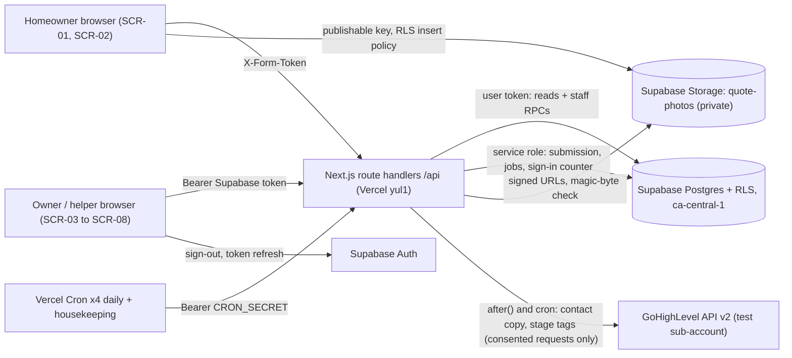
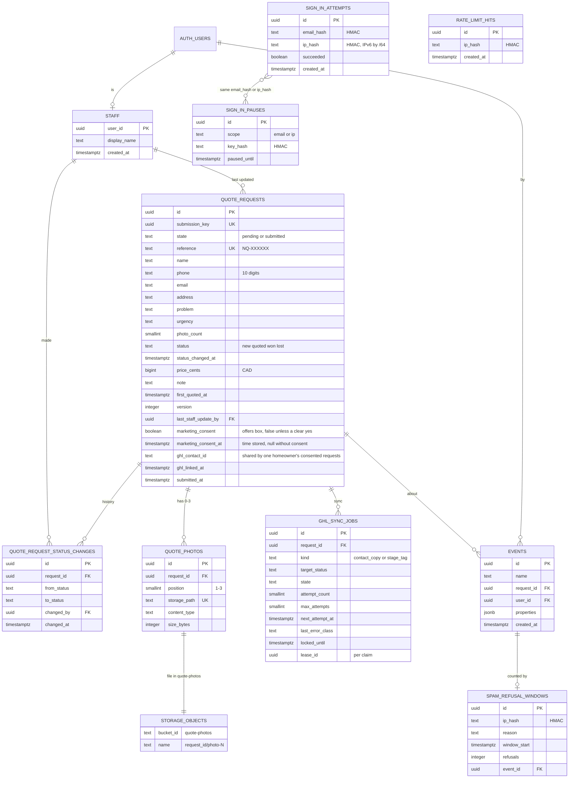

# Architecture: Northside quote requests

**Status:** proposed (locked at Gate 2), revised after the S0 threat model (Pass 2, `.baseleap/reviews/S0.md`) and for PRD v1.2 (Pass 3: ledger rulings of 2026-11-20 on consent, one contact per homeowner, passwords, sign-in limits, the spam event cap and the Requests and Pipeline tabs) · **Decisions:** `docs/decisions/` (0001 to 0004) · **Security model:** `docs/SECURITY_MODEL.md` · **Contract:** `docs/openapi.yaml` · **Integration contract:** `docs/integration-contract.md`

## Summary
One Next.js (App Router, TypeScript strict) app on Vercel (`yul1`), backed by one Supabase project per environment in ca-central-1 (Postgres with RLS on every table, Auth for the two staff, a private Storage bucket for photos). It is the house stack with no deviations (decision 0001). Homeowners submit through a public page in two calls with photos uploaded straight to Storage, with an optional, never-ticked offers box (decision 0002); the owner and helper sign in through our server (limited per email and per network address, counters in Postgres) and work two tabs with their own addresses, Requests (`/requests`, the list) and Pipeline (`/pipeline`, the four-column board), with every write going through a database function that checks a 7-day staff session and a version number (decision 0003). Each stored request and each status change **of a request whose homeowner ticked the offers box** queues a one-way GoHighLevel sync job that runs right after the response and is retried by four daily Vercel Cron runs, which fits the Hobby plan at $0; one homeowner has one GHL contact, matched by email or phone, and its stage tag follows the most recent change (decision 0004). Unticked requests never reach GHL. Build mode is hybrid: our app is the system of record and GHL only receives a contact copy and stage tags.

## System diagram


### Submission sequence (decision 0002)
```mermaid
sequenceDiagram
  participant B as Homeowner browser
  participant A as /api
  participant S as Supabase Storage
  participant D as Postgres
  B->>A: GET / (rendered per request, Cache-Control private no-store, fresh token)
  B->>A: POST /quote-requests (X-Form-Token, fields, offers choice, photo plan)
  A->>A: token >= 3 s, honeypot empty, validate; offers choice = (value === true)
  A->>D: refused? record_spam_refusal() (capped event), same refusal body
  A->>D: start_quote_request(): lock on the nonce, replay or rate-limit slot + insert pending (one call, service role)
  A-->>B: 201 request_id + upload paths (200 replay, 409 form_already_used, 429)
  B->>S: upload photo-1..n (publishable key; RLS: own pending folder, max 3)
  B->>A: POST /quote-requests/{id}/submission (same token)
  A->>S: list + read first bytes, size (service role)
  A->>D: complete_quote_request(): photos, NQ- reference, consent time, copy job only if ticked, event (one transaction)
  A-->>B: 200 reference (SCR-02, the same whether ticked or not)
  A->>A: after(): first GHL copy attempt (only if a job was queued)
```

## Modules
| Module | Responsibility | Lives in | Lane |
|---|---|---|---|
| Env | the only reader of `APP_SIGNING_SECRET` and `CRON_SECRET`; lazily validated, refuses values under 32 characters (SECURITY_MODEL invariant 15) | `src/lib/server/env.ts` | backend |
| Form token | issue and verify `X-Form-Token` (HMAC, 3 s to 24 h); throws when the signing secret is missing or short | `src/lib/server/form-token.ts` | backend |
| Submissions | token, honeypot and zod checks (email trimmed before validation; `marketing_consent` coerced to `value === true`, never a 422), then one `start_quote_request()` call (one request per token, atomic rate limit with the address hashed per SECURITY_MODEL "Network address"), `record_spam_refusal()` after a honeypot, time-trap or rate-limit refusal (errors ignored, the refusal is unchanged), clear a pending request's uploads on `updated`, photo magic-byte, size and dimension check, call `complete_quote_request`, schedule the first GHL attempt only when it queued a job | `src/lib/server/services/submissions.ts`, `src/app/api/quote-requests/route.ts` (POST), `src/app/api/quote-requests/[request_id]/submission/route.ts` | backend |
| Inbox reads | list (cursor, status, search) through the `list_quote_requests` RPC only, never a PostgREST filter string; detail (signed photo URLs, GHL state mapping, last updated), photos refresh, weekly count, staff me | `src/lib/server/services/quote-requests.ts`, `src/app/api/quote-requests/route.ts` (GET), `src/app/api/quote-requests/[request_id]/route.ts`, `.../photos/route.ts`, `src/app/api/weekly-counts/current/route.ts`, `src/app/api/staff/me/route.ts` | backend |
| Inbox writes | price and note, status change (RPCs), schedule the stage-tag attempt | `src/lib/server/services/quote-requests.ts`, `.../quote/route.ts`, `.../status-changes/route.ts` | backend |
| Auth | sign-in with the per-email and per-address limits (`take_sign_in_attempt(email_hash, ip_hash)` before Supabase Auth, 503 `sign_in_unavailable` on any error, no `Retry-After` on 429; `mark_sign_in_succeeded` after a staff sign-in), route auth helper (`requireStaff`), session refresh, page redirects to `/sign-in?next=` with the allow-list of SECURITY_MODEL invariant 22, per-request CSP nonce | `src/lib/server/auth/**`, `src/app/api/auth/sign-in/route.ts`, `src/proxy.ts` | backend |
| HTTP plumbing | wraps every route handler: problem+json responses, PostgREST error mapping (`PT401` → 401, `PT404` → 404, `PT409` → 409, `PT422` → 422, `23514` → 422 with our own field messages, `23505` on `submission_key` → the replay), catches unhandled errors and logs `{ error_class, code }` only (never `message`, `details`, `hint` or the error object), 405 handlers, security headers | `src/lib/server/http.ts`, `next.config.*` headers (A2 scaffolds) | backend |
| Events and logs | write `events` rows (ids only), structured JSON logs with an allow-list of fields (Observability) | `src/lib/server/events.ts`, `src/lib/server/log.ts` | backend |
| Housekeeping | purge stale pending requests and their files, and every counter row older than 24 h (`rate_limit_hits`, `spam_refusal_windows`, `sign_in_attempts`, `sign_in_pauses`) | `src/lib/server/jobs/housekeeping.ts`, `src/app/api/jobs/housekeeping/route.ts` | backend |
| GHL client and runner | GHL HTTP client (token, version, timeout, error classes including `rejected` for 400/404/422, production base URL fixed), contact copy by the match rule (`find_ghl_contact_match`, then GHL duplicate search, then create; a 400 on create repeats the search once, then `rejected`), stage tags from `ghl_stage_for_request` (last change wins), claim one job per lease and settle it with that lease, contact id check, manual retry | `src/lib/server/integrations/ghl/**`, `src/lib/server/jobs/ghl-sync.ts`, `src/app/api/jobs/ghl-sync/route.ts`, `src/app/api/quote-requests/[request_id]/ghl-copy-retries/route.ts` | integration |
| Public pages | SCR-01 form, rendered per request (`await connection()` before `issueFormToken()`, `Cache-Control: private, no-store`); a fresh token after every completed submission; photo picker and direct upload; SCR-02 (reference kept in `sessionStorage` for reloads in the same tab). See "Build requirements from S0" | `src/app/(public)/page.tsx`, `src/app/(public)/request-sent/page.tsx`, `src/components/request/**` | frontend |
| Staff pages | SCR-03 sign-in, the shared tab navigation, SCR-04 Requests tab, SCR-05 Pipeline tab (drag plus Move to), SCR-06 detail (under either tab), SCR-07 strip (on both tabs), SCR-08 viewer | `src/app/(public)/sign-in/page.tsx`, `src/app/(staff)/layout.tsx` (tab bar), `src/app/(staff)/requests/**`, `src/app/(staff)/pipeline/**`, `src/components/staff/**` | frontend |
| API client | Orval-generated fetchers, TanStack Query hooks, Zod schemas, MSW mocks; one hand-written fetcher | `src/lib/api/generated/**` (generated), `src/lib/api/fetcher.ts` | architect (generated) / frontend (fetcher) |

**Integration seam.** `src/lib/server/integrations/ghl/index.ts` exports `runGhlJobs(options: { requestId?: string; limit?: number }): Promise<JobRunResult>`. Backend routes call it inside `after()` after a submission completes and after a real status change; the cron route calls it with no `requestId`. A2 scaffolds it as a no-op stub returning zero counts so the backend lane never waits on the integration lane.

**GHL state shown on SCR-06** (backend maps the request and its job rows to the contract's `ghl` object):
- **No consent first:** `marketing_consent` false → `copy` = `{ state: not_copied_no_consent, at: null }` and `stage_tag` = `null` (the UI shows "Not copied: no offers consent", no Retry, no stage-tag line; AC-010.6, AC-017.16). Such a request has no job rows.
- `copy`: job `succeeded` → `copied` (at = `last_attempt_at`); `pending` or `waiting` → `waiting` (at = `last_attempt_at`); `failed` → `failed` (at = `last_attempt_at`). A request linked to the homeowner's existing contact shows `copied` like any other.
- `stage_tag`: the newest non-superseded `stage_tag` job decides (`succeeded` → `up_to_date`, `pending`/`waiting` → `waiting`, `failed` → `failed`). With no such job, it follows the copy (`copied` → `up_to_date`, `waiting` → `waiting`, `failed` → `failed`), because the contact is created or linked with the current stage tag.

### Routes and screens
Navigation rule (`ux-flows` §2, PRD FR-26): every feature is its own tab with its own address, never a toggle. Requests and Pipeline are separate routes; there is no `view` parameter and no List / Board switch. The list and the board share one API operation (`listQuoteRequests`).

| Screen | Route | Operations |
|---|---|---|
| SCR-01 Request a quote | `/` | `createQuoteRequest`, `uploadQuotePhoto` (supabase-js), `submitQuoteRequest` |
| SCR-02 Request sent | `/request-sent` (reads `sessionStorage`; without it, redirects to `/`) | none |
| SCR-03 Staff sign-in | `/sign-in`, optionally `/sign-in?next=/pipeline` (or any path allowed by SECURITY_MODEL invariant 22); after sign-in goes to `next`, else `/requests` (AC-004.1, AC-004.3, AC-004.14). Messages: wrong credentials (401), too many attempts (429, one message for both limits), unavailable (503 `sign_in_unavailable`), session ended | `signIn`; sign-out with `supabase.auth.signOut()` |
| SCR-04 Requests tab | `/requests` (sign-in lands here; tab marked with `aria-current="page"`). Filter and search are client state (not in the address, so search text never reaches page-URL logs) | `listQuoteRequests` (status, q), `changeQuoteRequestStatus`, `getCurrentWeeklyCount`, `getCurrentStaff` |
| SCR-05 Pipeline tab | `/pipeline` (its own address, opens directly, AC-016.19) | `listQuoteRequests` once per column (status = new, quoted, won, lost; never `q`), `changeQuoteRequestStatus`, `getCurrentWeeklyCount`, `getCurrentStaff` |
| SCR-06 Request detail | `/requests/[request_id]` and `/pipeline/[request_id]`: the same screen under the tab the owner came from, so the path marks the current tab and sets "Back to Requests" or "Back to Pipeline" (which restores filter, search and scroll from client state). Opened with no origin, `/requests/[request_id]` is the canonical address | `getQuoteRequest`, `saveQuote`, `changeQuoteRequestStatus`, `retryGhlCopy` (Could; never shown for an unticked request) |
| SCR-07 Weekly count | strip on SCR-04 and SCR-05 (both tabs, OQ-18A) | `getCurrentWeeklyCount` (refetched after every successful status change) |
| SCR-08 Photo viewer | dialog on SCR-06 | `listQuoteRequestPhotos` when opened and when a URL is near expiry |

Signed-out visits to `/requests`, `/pipeline` or either detail path are redirected by `src/proxy.ts` to `/sign-in?next=<that path>`. There is no `/inbox` route, and no page, link or route for sign-up, password change or password reset (NG-4, FR-27).

## Data model


Migrations: `supabase/migrations/20261120000100_extensions_and_helpers.sql` (pgcrypto, `app_private`), `..0200_staff.sql`, `..0300_quote_requests.sql` (including consent, the link time, the contact match indexes and the consent-immutability trigger), `..0400_ghl_sync.sql` (including the consent trigger on jobs), `..0500_events_and_limits.sql` (events, the four counter tables), `..0600_functions.sql` (RPCs and server functions), `..0700_storage.sql` (bucket and `storage.objects` policies). Pass 3 edited these files in place rather than adding new ones, because none has been applied to any database yet (A2 runs them first); once A2 applies them, every change is a new migration. Every table (10) has RLS enabled **and forced**, with explicit grants.

**Data rules from PRD v1.2:**
- **Consent (FR-25, ruling 1B).** `marketing_consent` (not null, default false) and `marketing_consent_at` (set by `complete_quote_request` to the time the request is stored). Checks: no time without consent; a submitted request with consent has its time; `ghl_contact_id` only with consent. Triggers: a stored request's consent never changes (NG-16); a `ghl_sync_jobs` row can only be inserted for a consented request, and an existing job can be neither repointed (`request_id`) nor re-kinded (`kind`) onto a request without consent (`before insert or update of request_id, kind`, S0 SEC-23). Other updates (the runner settling `state`, attempts, lease) do not fire it.
- **One contact per homeowner (FR-15, ruling 2A).** Match rule: same email (trimmed, lower-cased) or same 10-digit phone, implemented once in `find_ghl_contact_match()`; several requests may hold one `ghl_contact_id`. "Last change wins" is `ghl_stage_for_request()`: among the consented requests linked to one contact, the latest of `greatest(ghl_linked_at, status_changed_at)` decides the stage tag. Contact fields are never written after creation (OQ-19A).
- **Sign-in limits (FR-9, ruling 4A).** `sign_in_attempts` gains `ip_hash`; `sign_in_pauses` records each pause (scope email or ip, `paused_until`), which also marks where the count restarts.
- **Spam event cap (FR-8, SEC-14).** `spam_refusal_windows` holds the address key and the open window per address and reason; `events.properties.count` mirrors its `refusals`. The only update ever made to `events` is that count (column grant on `properties` to `service_role`). Tests: `supabase/tests/rls/*.sql` (one per table, storage, and `all_tables.sql` for catalog-wide rules and the BYPASSRLS check) and `supabase/tests/functions/*.sql`. pgTAP is not in any migration: each test file installs it inside its own transaction, so it never reaches production (S0 SEC-18).

`on delete` choices: photos, history, jobs and events **cascade** from `quote_requests` (a by-hand privacy deletion removes everything about the request); staff references **set null** (history survives a removed account); `staff.user_id` **cascades** from `auth.users`; `spam_refusal_windows.event_id` **cascades** from `events` (a window means nothing without its event).

Key queries and their indexes:
| Query (screen, story) | Index |
|---|---|
| Requests tab newest first, 50 per page, keyset cursor (SCR-04, US-005), through `list_quote_requests` | `quote_requests_inbox_idx (submitted_at desc, id desc) where state = 'submitted'` |
| Requests tab filtered by status, and each Pipeline column (SCR-04, SCR-05, US-011, US-016), through `list_quote_requests` | `quote_requests_status_inbox_idx (status, submitted_at desc, id desc) where state = 'submitted'` |
| Requests this week (SCR-07, US-008) | `quote_requests_inbox_idx` (range on `submitted_at`) |
| Won / Lost this week (SCR-07, US-008) | `quote_requests_status_changed_idx (status, status_changed_at) where state = 'submitted'` |
| Request by id (SCR-06) | primary key |
| Replay of a form token (US-001), in `start_quote_request` | unique `submission_key` |
| Photos of a request in order (SCR-06, SCR-08) | unique `(request_id, position)` |
| Staff photo read policy: is this object recorded? (SCR-06, SCR-08) | unique `quote_photos.storage_path` |
| Copy job and latest stage-tag job of a request (SCR-06) | `ghl_sync_jobs_request_idx (request_id, kind, created_at desc)` |
| Due sync jobs, one per claim (runner, `claim_ghl_job`) | `ghl_sync_jobs_due_idx (next_attempt_at) where state in ('pending','waiting')` |
| Contact match: another consented, linked request with the same email or phone (US-009, AC-009.10, AC-009.11), in `find_ghl_contact_match` | `quote_requests_contact_email_idx (lower(btrim(email)), ghl_linked_at desc) where ghl_contact_id is not null` and `quote_requests_contact_phone_idx (phone, ghl_linked_at desc) where ghl_contact_id is not null` (one per half of the "or") |
| Requests sharing one contact, for last change wins (US-017, AC-017.15), in `ghl_stage_for_request` | `quote_requests_ghl_contact_idx (ghl_contact_id) where ghl_contact_id is not null` |
| Accepted submissions per address, last 10 min (US-003), in `take_submission_slot` | `rate_limit_hits_ip_created_idx (ip_hash, created_at desc)` |
| Open spam window of one address and reason (US-003, AC-003.7), in `record_spam_refusal` | `spam_refusal_windows_key_idx (ip_hash, reason, window_start desc)` |
| Spam events today, for the 1,000 cap (AC-003.8), in `record_spam_refusal` | `events_name_created_idx (name, created_at)` (at most 1,000 rows in range) |
| Failed sign-ins per email since its last pause, last 15 min (US-004, AC-004.5), in `sign_in_pause_until` | `sign_in_attempts_email_created_idx (email_hash, created_at desc)` |
| Failed sign-ins per address since its last pause, last 15 min (US-004, AC-004.11), in `sign_in_pause_until` | `sign_in_attempts_ip_created_idx (ip_hash, created_at desc)` |
| Latest pause of an email or address (US-004), in `sign_in_pause_until` | `sign_in_pauses_key_idx (scope, key_hash, paused_until desc)` |
| Stale pending purge (housekeeping) | `quote_requests_pending_created_idx (created_at) where state = 'pending'` |
| Metrics by event and window | `events_name_created_idx (name, created_at)` |
| Search by reference, name, phone (US-013, Could), through `list_quote_requests` | none on purpose: about 2,400 rows a year, a filtered scan is milliseconds |

## Direct Supabase access (no API route)
| Table | Operations | Why RLS alone is enough |
|---|---|---|
| none (no `public` table) | none | every table read and write goes through `/api` |
| Storage `quote-photos` (anon) | insert into `{request_id}/photo-N` | the insert policy enforces own pending folder, planned position, 60-minute window and at most 3; the server re-checks the bytes before completing |
| Supabase Auth (staff) | sign-out, token refresh | no data; handled by `@supabase/ssr` |

## Stories served without the API
| Story | Why |
|---|---|
| US-004 (part) | Sign-out and access-token refresh use the Supabase Auth client (`supabase.auth.signOut()`, `@supabase/ssr`), and signed-out page visits are redirected to `/sign-in?next=<tab path>` by `src/proxy.ts` (return to the tab opened, AC-004.14); sign-in itself is `signIn` and the staff check is `getCurrentStaff`. Passwords are set and reset by Baseleap in the Supabase dashboard, with no operation in the app (FR-27, AC-004.10). |
| US-002 (part) | The photo bytes go straight to Supabase Storage (`uploadQuotePhoto` documents it, but Supabase implements it), because Vercel functions refuse bodies over 4.5 MB. |
| US-001 (part) | SCR-02 surviving a reload in the same tab is client state (`sessionStorage`), per the designer's ruling; there is no lookup endpoint (NG-3). |
| US-016 (part) | Dragging, the "Saving" state, the revert on failure and the screen-reader message are client-only; the move itself is `changeQuoteRequestStatus`. |

## Lane ownership (copied into build steps)
- **Backend:** `src/proxy.ts`, `src/app/api/**` except `src/app/api/jobs/ghl-sync/**` and `src/app/api/quote-requests/[request_id]/ghl-copy-retries/**`; `src/lib/server/**` except `src/lib/server/integrations/**` and `src/lib/server/jobs/ghl-sync.ts` (services, auth, form token, http, log, env, events, housekeeping; `src/lib/server/admin.ts` is created by A2 and edited only by backend); `supabase/seed.sql`; `tests/api/**`; `tests/helpers/**`
- **Integration:** `src/lib/server/integrations/**` (GHL client, contact copy, stage tags, runner, `index.ts` seam), `src/lib/server/jobs/ghl-sync.ts`, `src/app/api/jobs/ghl-sync/**`, `src/app/api/quote-requests/[request_id]/ghl-copy-retries/**`, `tests/integrations/**`, `tests/mocks/**` (GHL stub server), `docs/integrations/**`
- **Frontend:** `src/app/(public)/**`, `src/app/(staff)/**`, `src/components/**`, `src/hooks/**`, `src/lib/api/fetcher.ts`, `src/lib/supabase/browser.ts` (sessionless client for uploads, session client for auth), `src/lib/utils.ts`, `src/mocks/**`
- **DevOps:** `.github/**`, `vercel.json` (the four `ghl-sync` cron entries at `0 0 * * *`, `0 6 * * *`, `0 12 * * *`, `0 18 * * *` and one `housekeeping` entry at `30 7 * * *`, all UTC; function region `yul1`), `infra/**`, `scripts/install-scanners.sh`, `scripts/env-check.mjs`, `scripts/smoke.mjs`, `.env.example`, `docs/runbook.md`, `docs/deployments/**`
- **Architect (contract; changes through a contract question):** `docs/openapi.yaml`, `docs/integration-contract.md`, `supabase/migrations/**`, `supabase/tests/**`, `orval.config.ts`, `src/lib/shared/**`, generated `src/lib/api/generated/**` and `src/types/database.ts`; scaffold-only files from A2: `src/app/layout.tsx`, `src/app/globals.css`, `next.config.*`, `package.json`, `package-lock.json`, `tsconfig.json`, `eslint.config.*`, `postcss.config.*`, `vitest.config.*`, `vitest.setup.*`, `components.json`, `.nvmrc`, `supabase/config.toml` (local stack only), `supabase/scripts/**` (`db.mjs`: `db:migrate`, `db:test`, `db:check` and `gen:types` on staging; `db:test:local` and `gen:types:local` on the local stack). A lane that needs a new dependency asks through a contract question; the architect adds it.
- **Designer (generated):** `src/app/theme.css`
- **QA:** `tests/e2e/**`, `tests/fuzz/**`, `playwright.config.ts`, `docs/test-plan.md`, `docs/qa-reports/**`
- **Security:** `.opengrep/**`, `.gitleaks.toml`, `scripts/security-scan.sh`

Orval note for A2: generate from `docs/openapi.yaml` excluding the `Photo storage` tag (`uploadQuotePhoto` is implemented by Supabase and called through supabase-js). `QuoteRequestCreate.marketing_consent` has no type on purpose (anything but `true` is "no", AC-001.17), so Orval generates `unknown` for it; the frontend sends a boolean and the backend coerces with `value === true`.

### Fonts for A2 (DESIGN.md typography)
DESIGN.md sets **Barlow Semi Condensed** (SemiBold 600, Bold 700; headings, display, the reference tag) and **Source Sans 3** (Regular 400, SemiBold 600; body, labels, buttons), both SIL Open Font License, **self-hosted, never from a font CDN** (CSP `font-src 'self'`, SECURITY_MODEL invariant 13). A2 installs these two packages as regular dependencies (open licence, no cost, no network at runtime):
- `@fontsource/barlow-semi-condensed` (5.3.0 on npm, read 2026-11-20; files used: latin 600 and 700, normal)
- `@fontsource/source-sans-3` (5.3.1 on npm, read 2026-11-20; files used: latin 400 and 600, normal)

Load them in `src/app/layout.tsx` with `next/font/local`, pointing `src` at the latin woff2 files inside `node_modules/@fontsource/<family>/files/` (fontsource names them `<family>-latin-<weight>-normal.woff2`; A2 confirms the exact names after `npm ci`), with `display: 'swap'`, `preload: true` for the weights above the fold, and the fallbacks DESIGN.md names (`Arial Narrow` for headings, `system-ui` for body). Expose them as CSS variables that `src/app/theme.css` (designer, generated) reads; do not hand-edit `theme.css`. `next/font/local` copies the files into the build output and serves them from our own origin, which keeps `font-src 'self'` true. (Importing the packages' `latin-600.css` style files instead also works but gives no preload; prefer `next/font/local`.) Set the body background and text colour from DESIGN.md tokens in `src/app/globals.css`. Afterwards the designer copies the same four woff2 files from `node_modules/@fontsource/*/files/` into `design/fonts/` for the mockups (D1 report, "Fonts").

### Build requirements from S0 (copied into build steps)
Each line is a requirement on that lane's step, with the SECURITY_MODEL invariant or section that states it and the check that proves it.
- **Frontend (SEC-2):** `src/app/(public)/page.tsx` calls `await connection()` from `next/server` before `issueFormToken()`; the page is never static, ISR or CDN-cached. After `submitQuoteRequest` succeeds, or `createQuoteRequest` returns 200 with `submission_state: submitted`, the page drops its token and calls `router.refresh()` before another submission is allowed. The nonce of each completed submission goes into `sessionStorage`; on mount and on `pageshow` a page whose token is listed refreshes first. On 409 `form_already_used` or 400 `form_expired`, refresh the token, keep every typed value, and let the homeowner send again. (SECURITY_MODEL "The public formToken scheme".)
- **Frontend (SEC-16):** show staff photos with a plain ``, never `next/image` remote optimisation. (Invariant 7.)
- **A2 scaffold (SEC-2, SEC-15):** no `export const dynamic = 'force-static'`, `revalidate` or `"use cache"` on `/` or the root layout. `next.config.*` `headers()` sends `Cache-Control: private, no-store` on `/` explicitly (Next.js fixes `Cache-Control` only for immutable hashed assets; other responses may set it: https://nextjs.org/docs/app/api-reference/config/next-config-js/headers, updated 2026-06-30), plus the other security headers of invariant 13. The CSP is set by `src/proxy.ts` with a per-request nonce (backend). QA checks the header on the deployed preview, because the local dev server is not proof of what Vercel serves.
- **Backend (SEC-2, SEC-3):** create calls `start_quote_request()` once and maps its outcome: `created` 201, `replayed` 200, `updated` 200 after removing that request's uploaded objects, `token_used` 409 `form_already_used`, `rate_limited` 429 with `Retry-After`. A `23505` on `submission_key` is answered as the replay, never 500. The address is hashed per SECURITY_MODEL "Network address" (IPv6 cut to /64, input `ip|v1|...`), unit-tested. Sign-in calls `take_sign_in_attempt()` before Supabase Auth and `mark_sign_in_succeeded()` only for a staff sign-in. (Invariant 16.)
- **Backend (SEC-4):** `src/lib/server/env.ts` per invariant 15; `/api/jobs/*` per invariant 12. Tests: `Bearer undefined`, `Bearer ` and no header each give 401 on both job routes; a missing or short `APP_SIGNING_SECRET` gives 503 on the form-token routes and sign-in.
- **Backend (SEC-5):** `log.ts` allow-list and the `http.ts` wrapper per invariant 11. Test: force a `23514` on create; neither the captured log line nor the response contains the submitted name, phone or email.
- **Backend (SEC-13):** the list uses `list_quote_requests` with typed parameters; the cursor is decoded and validated (400 on a bad cursor) before the call; no `.or()` or `.filter()` string is built from input.
- **Backend (SEC-15):** `src/proxy.ts` sets the CSP of invariant 13 with a fresh nonce per request.
- **Integration (SEC-7, SEC-12, SEC-20):** per `docs/integration-contract.md` "Sync jobs" and "Credentials and scopes": claim one job at a time with `claim_ghl_job`, pass its `lease_id` to `finish_ghl_job`, stop claiming when less than 60 s of the 300 s budget is left; validate the contact id and `encodeURIComponent` it; ignore `GHL_API_BASE_URL` in production.
- **DevOps (SEC-4, SEC-10):** `scripts/env-check.mjs` fails when `APP_SIGNING_SECRET` or `CRON_SECRET` is missing from the Production or Preview rows (values are never read or printed); the runbook says custom SMTP is never configured on these Supabase projects without a security review.
- **QA (from S0):** two GETs of `/` return different nonces and a `Cache-Control` containing `no-store`; submit, press Back, change the details and send again: two requests with two references (or one 409 then a fresh-token success), never a merge; 20 parallel creates from one address accept exactly 5; 20 parallel sign-in failures for one email reach Auth at most 5 times; `Bearer undefined` on both job routes gives 401.

### Build requirements from PRD v1.2 (copied into build steps)
- **Backend (1B, FR-25):** `QuoteRequestCreate.marketing_consent` is coerced with `value === true` before anything else (a string `"true"`, `"yes"`, `"maybe"`, `1`, `null` or a missing key are all `false`), never a 422 (AC-001.17); pass it to `start_quote_request(..., p_marketing_consent)`. Trim `email` before validating and storing it. `getQuoteRequest` returns `marketing_consent`, `marketing_consent_at`, and `ghl` per "GHL state shown on SCR-06" (no consent → `not_copied_no_consent`, `stage_tag: null`). `retryGhlCopy` maps the RPC's PT409 to 409 `not_retryable` with no GHL call (AC-014.4). Schedule the `after()` GHL attempt only when a job was queued.
- **Backend (SEC-14, FR-8):** after a honeypot, time-trap or rate-limit refusal call `record_spam_refusal(ip_hash, reason)` once; ignore its errors (log `{ error_class, code }` only) and send the identical refusal either way. Remove any direct insert of `spam_submission_blocked`.
- **Backend (4A, FR-9):** sign-in calls `take_sign_in_attempt(email_hash, ip_hash)` (address hashed as SECURITY_MODEL "Network address", `ip|v1|unknown` when none); `allowed: false` → 429 `sign_in_paused` with no `Retry-After`; any thrown error → 503 `sign_in_unavailable` and Supabase Auth is not called (AC-004.13). Housekeeping purges `spam_refusal_windows` and `sign_in_pauses` with the other counters. Tests: 5 emails × 4 failures from one address then a 21st attempt → 429; the same credentials from another address → 200; a forced database error → 503 with no Auth call.
- **Backend (FR-26, invariant 22):** `src/proxy.ts` redirects signed-out visits to `/requests`, `/pipeline` and the two detail paths to `/sign-in?next=<path>`; the sign-in page follows `next` only when it matches the allow-list, else `/requests`. Test: `next=https://evil.example`, `next=//evil.example`, `next=/%2F%2Fevil.example` all land on `/requests`.
- **Integration (2A, `rejected`, 400):** per `docs/integration-contract.md` "Contact match rule" and "When the platform is down": `find_ghl_contact_match()` first, then GHL duplicate search, then create; tags from `ghl_stage_for_request()` on every link and every stage-tag attempt; settle a link with `finish_ghl_job(..., 'succeeded', null, contact_id)`; 404 and 422 → `rejected`; 400 on create → one more duplicate search in the same attempt, then link or `rejected`; 400 on a tag call → `rejected`. Tests with the GHL stub: an unticked request makes zero stub calls; a second ticked request with the same email (and one with the same phone) makes no create call and sends no contact fields; AC-017.15's order of changes ends with `quote-lost`.
- **Frontend (FR-26, 1B, 3A):** two tabs at `/requests` and `/pipeline` in one navigation landmark (`aria-current="page"` on the current tab), no List / Board switch; detail at `/requests/[request_id]` and `/pipeline/[request_id]`; the offers checkbox is never ticked on load, by script or by autofill, and its state is kept on every refusal (AC-001.16); SCR-06 shows "Not copied: no offers consent" with no Retry and no stage-tag line when `ghl.copy.state` is `not_copied_no_consent`; SCR-03 shows the 503 message and has no forgot-password link; no page or link changes or resets a password.
- **DevOps (3A):** runbook: Authentication → Providers → Email minimum password length 12 and "Require reauthentication when changing password" on, in both Supabase projects; Baseleap sets each staff password (12+ characters, different per account) and resets forgotten ones in the dashboard; custom SMTP is never configured without a security review.
- **QA (PRD v1.2):** AC-001.14 to AC-001.18, AC-003.7, AC-003.8, AC-004.10 to AC-004.14, AC-005.10, AC-009.9 to AC-009.13, AC-010.6, AC-014.4, AC-016.19, AC-016.20, AC-017.15 to AC-017.17. A direct POST with `"marketing_consent": "maybe"` is stored as no (AC-001.17). The 429 for sign-in carries no `Retry-After`. `/inbox` returns 404.

### Checks for A2 on staging (S0 SEC-1)
Run after the migrations, before anything else, on the staging database:
1. `select rolname, rolbypassrls from pg_roles where rolname in ('postgres', 'service_role');` must return `true` for both. `supabase/tests/rls/all_tables.sql` asserts the same. If either is `false`, **stop and raise a contract question; never drop `force row level security`.** In that case the staff RPCs, `is_staff()`, `current_staff()` and the upload policy fail closed (no access), while the service-role functions keep working only if `service_role` is the one with the attribute.
2. `select relname, relrowsecurity, relforcerowsecurity from pg_class c join pg_namespace n on n.oid = c.relnamespace where n.nspname = 'public' and c.relkind = 'r';` must show `true, true` on every row.
3. `npm run db:test` passes every file, including `supabase/tests/functions/*.sql` (the definer RPCs under forced RLS).
4. The other live checks in `docs/threat-model.md` "Live checks for A2".

All four run as `npm run db:test` then `npm run db:check` (read-only). **Result on staging, 2026-11-20:** BYPASSRLS true for both roles, RLS enabled and forced on all 10 tables, 16/16 pgTAP files, 346 assertions, 15/15 catalog checks, pgTAP absent afterwards.
- **Platform-installed function (found on the first apply).** A project created with Supabase's "automatically enable RLS on new tables" option has the event trigger `ensure_rls` and its function `public.rls_auto_enable()` (owner postgres, SECURITY DEFINER, returns `event_trigger`), which the default privileges make executable by anon. Migration `20261120000800_platform_function_grants.sql` revokes EXECUTE from public, anon, authenticated and service_role when the function exists (the event trigger keeps firing). The production project may or may not have the option on; the guarded migration covers both. `db:check` lists every event trigger for the record.
- **Staff accounts.** Baseleap creates the auth user in the dashboard, then runs `npm run db:staff-add -- <email> [display name]` (idempotent; `owner` → "Owner", `helper` → "Office helper" by default). Staging: `owner@northside.test` and `helper@northside.test` are staff. Count-based pgTAP assertions on `public.staff` compare with the table's real total, so real staff rows don't break `db:test`.

## Environment variables (names only — values are set by Matthew)
| Name | Used by | Server-only? |
|---|---|---|
| `NEXT_PUBLIC_SUPABASE_URL` | client + server | no |
| `NEXT_PUBLIC_SUPABASE_ANON_KEY` | client + server (publishable key; the photo upload and Auth) | no |
| `SUPABASE_SERVICE_ROLE_KEY` | `src/lib/server/admin.ts` only (importers listed in SECURITY_MODEL invariant 2) | **yes** |
| `SITE_URL` | server (absolute URLs) | yes |
| `APP_SIGNING_SECRET` | read only by `src/lib/server/env.ts`; used by the form token and the IP and email HMACs. At least 32 characters (generate 32+ random bytes); unset or shorter → the form-token routes and sign-in answer 503 (SECURITY_MODEL invariant 15). In `docs/ops/account-setup.md` | **yes** |
| `CRON_SECRET` | read only by `src/lib/server/env.ts`; `/api/jobs/*` (Vercel sends it as Bearer on cron calls). At least 32 characters; unset or shorter → every job call is 401 (invariant 12). In `docs/ops/account-setup.md` | **yes** |
| `GHL_PRIVATE_INTEGRATION_TOKEN` | `src/lib/server/integrations/ghl/client.ts` only; scopes in `docs/integration-contract.md` | **yes** |
| `GHL_LOCATION_ID` | GHL client (test sub-account id, not secret) | yes |
| `GHL_API_BASE_URL` | GHL client; optional, defaults to `https://services.leadconnectorhq.com`, tests point it at a stub. **Ignored when `VERCEL_ENV` is `production`** (invariant 9) | yes |
| `VERCEL_ENV` | GHL client (production base URL lock); Vercel system variable | yes |
| `VERCEL_GIT_COMMIT_SHA` | `/api/health` version (Vercel system variable) | yes |
| `SUPABASE_STAGING_DB_URL` | migrations and RLS tests from the orchestrator machine and the GitHub `staging` environment only, never the app | yes |

## Capacity & reliability
| Concern | Expected (from PRD) | Plan |
|---|---|---|
| Volume | up to 200 requests and 600 photos a month (design assumption), 2 users; about 2,400 requests, 7,000 status changes, 25,000 events and at most 10,000 job rows a year (fewer now: only consented requests get jobs) | well inside Supabase Free's 500 MB database; every list is cursor-paginated (50) and index-backed; no unbounded query (the Pipeline tab is four paginated calls) |
| Bot floods (spam events, sign-in guessing) | worst case: refusals from thousands of addresses a day | `spam_submission_blocked` capped at 1 per address and reason per 10 min and 1,000 a day, and past the cap nothing is written, so at most about 1,000 event rows and 1,000 window rows a day; sign-in rows are one per allowed attempt, capped at 1,440 a day per email and 1,920 a day per address by the pauses; all counter rows purged after 24 h |
| Photo storage | 600 photos a month at 2 to 5 MB | **exceeds Supabase Free's 1 GB in about a month for a real client** (fine for the rehearsal's test data). DECISION line in the A1 report |
| Requests per day | about 7 submissions (3 calls each plus uploads), a few hundred staff reads | no caching, no queue beyond the job table |
| Largest list on a screen | 50 rows (list) or 4 x 50 cards (board) | `limit` max 100 |
| Slow work | GHL calls (up to 30 s when GHL is slow) | never inline in the response: `after()` (same invocation, within the 300 s cap) and cron; 10 s client timeout per GHL call |
| Photo upload | 3 x 5 MB on 4G within 20 s (AC-002.7) | direct to Storage in parallel; nothing passes through Vercel |
| Failure of GoHighLevel | down, slow, 429, token missing or revoked | request and status saved first; job retried with backoff; visible state on SCR-06 (`docs/integration-contract.md`, When the platform is down) |
| Failure of Supabase | database or Storage unreachable | submit: 503, nothing stored, everything kept on screen (AC-001.8); detail: photo URL null → "Photo unavailable" (AC-005.7); weekly count is its own call → "Count unavailable" (AC-008.8) |
| Supabase Free pause | projects pause after 1 week of inactivity | rehearsal staging may pause between runs (resume from the dashboard); a real client needs Pro or regular use. Listed as a risk |
| Rate limits | GHL 100 per 10 s and 200,000 a day per location | at most about 8 GHL calls per request; the runner claims one job at a time (120 s lease each) and stops claiming when less than 60 s of the 300 s function budget is left |

**Retry schedule (fits Vercel Hobby at $0).** First attempt inline with `after()`. Then due times after attempt n: 5 min, 1 h, 3 h, 6 h, 12 h. Four Vercel Cron entries run `/api/jobs/ghl-sync` daily at 00:00, 06:00, 12:00 and 18:00 UTC (each entry is once a day, which Hobby allows; ±59 min jitter), so the worst wait after a job is due is about 8 hours and the longest gap between two attempts is 12 h + 8 h = 20 hours, inside "at least every 24 hours". Up to 5 retries after the first attempt, then "failed". New submissions and status changes also drain due jobs with `after()`. No paid plan is needed; Vercel Pro would only make retries faster.

**Failure recovery for each Must flow**
| Flow | Partial failure | Repair |
|---|---|---|
| Submit (US-001, US-002, US-003) | database down at create → 503, nothing stored; two creates with one token at once → one request (lock in `start_quote_request`); an upload fails → that photo shows its error, the same token retries into the same pending request; submit fails → the transaction rolls back, nothing visible; the browser never returns → the pending row and files are purged after 24 h | retry by the homeowner; housekeeping job |
| Sign-in (US-004) | Supabase Auth unreachable → 500, nothing changes (the attempt stays counted as a failure, which fails closed); counters unreadable → 503 `sign_in_unavailable`, Auth not called, no session (AC-004.13) | retry in a few minutes |
| Consent and GHL (US-001, US-009) | a ticked request's copy fails → request and confirmation untouched, job retried; an unticked request → nothing to fail, no job exists | the job retries GHL by itself; Retry copy (Could) for a failed one |
| Inbox and detail (US-005) | Storage cannot sign a URL → that photo shows "Photo unavailable" | photos refresh call or reload |
| Price and note (US-006) | network drop or 409 → nothing stored (one transaction), typed values kept | retry, or reload on 409 |
| Status from the Requests or Pipeline tab (US-007, US-016) | save fails or 409 → nothing stored, the card returns; GHL down → status saved, stage tag waits (consented requests only) | retry; the job retries GHL by itself |
| Weekly count (US-008) | count call fails → "Count unavailable", list unaffected | Try again |
Nothing in these flows can be lost or doubled: every write is one transaction keyed by id, form-token nonce or version.

## Observability
- Health: `GET /api/health` → `{ status: "ok", version }` (no dependency checks; devops and QA rely on it).
- Logs: one JSON line per request from `src/lib/server/log.ts`. **Allow-list, nothing else is written** (any other field is dropped by `log.ts`): `level`, `request_id` (Vercel's `x-vercel-id`), `route` (the route pattern, never the URL or query string), `method`, `status`, `duration_ms`, `user_id` (staff only), `quote_request_id` where relevant, `outcome`, `error_class` and `code` (the SQLSTATE or provider status) for a failure, and for GHL `job_id`, `attempt`. Never tokens, secrets, cookies, names, phones, emails, addresses, problem text, notes, prices, network addresses, search text, or any error's `message`, `details`, `hint`, body or stack (Postgres errors carry the failing row: SECURITY_MODEL invariant 11).
- Errors: Vercel function logs (default). No Sentry (it would need a spend gate).
- Analytics events: exactly the metrics-spec events, written server-side to `public.events` in the same ca-central-1 project, ids, enums, booleans and counts only (`marketing_consent` on `quote_request_submitted`; `count` on `spam_submission_blocked`, raised in place by `record_spam_refusal`, the only update ever made to an event); read by staff and Baseleap. No GA4, Meta Pixel or GHL events (NG-11).
- Audit trail: `quote_request_status_changes` (append-only, written only by `change_quote_request_status`) plus `last_staff_update_by/at` on each request (US-015).
- Sync visibility: `ghl_sync_jobs` (state, attempts, last error class, next attempt) is the "needs attention" list; SCR-06 shows it per request.
