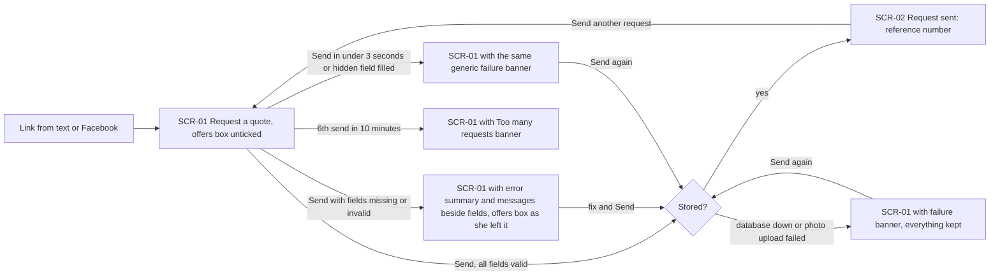
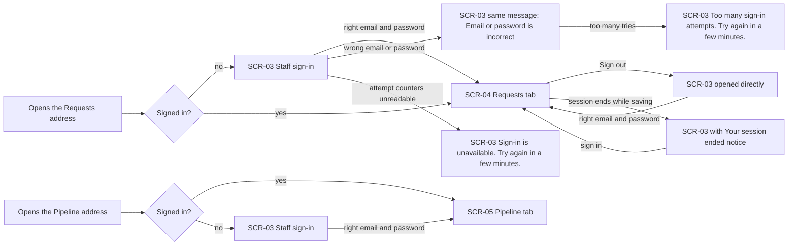
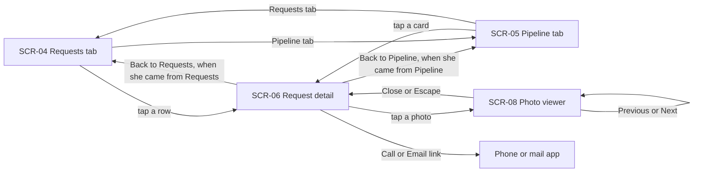
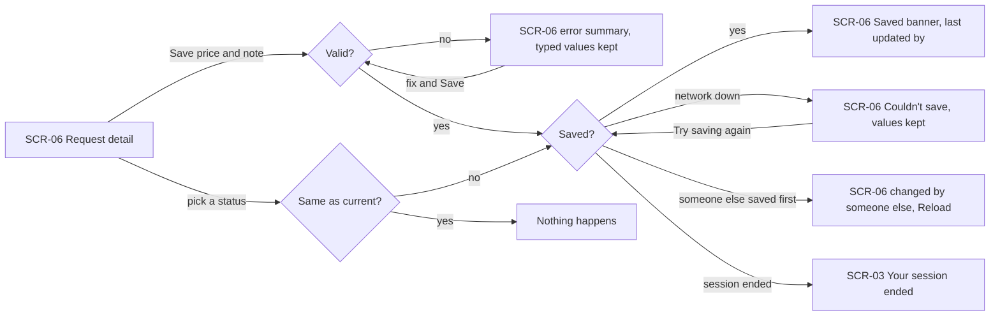
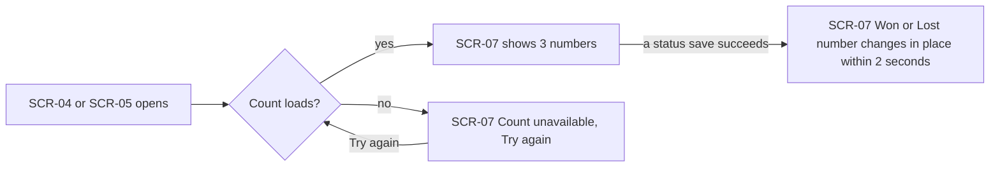
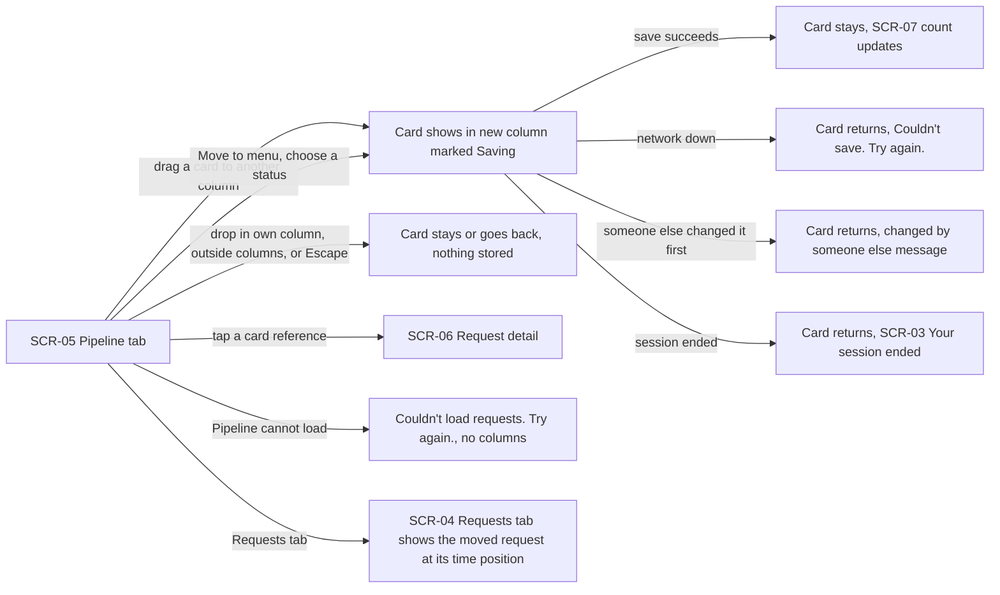
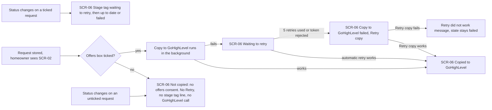

# User flows: Northside quote requests

Brand: the client's own brand guide and wordmark (see `DESIGN.md`). Personas: Homeowner (public, on a phone), Owner and office helper (signed in, identical rights).
Inputs: `docs/PRD.md` (v1.2), `docs/user-stories.md`, `docs/metrics-spec.md`. Specs, states and copy are in `docs/design-specs.md`. Mockups are in `design/mockups/`, screenshots in `docs/design/screens/`.

Scope note: none of these screens is placed inside a GoHighLevel page (Non-goal NG-11), so no screen has an embed width and none is designed to sit in a frame. Every screen is a normal page of the app.

## Screen inventory

| ID | Screen | Stories | Entry points | Access | Conversion | Data needs |
|---|---|---|---|---|---|---|
| SCR-01 | Request a quote | US-001, US-002, US-003 | A link Northside shares (text message, Facebook, website, business card); "Send another request" on SCR-02 | public | yes | Nothing to read. To send: name, phone, email, job address, problem text, one of three urgency choices, up to 3 photos (JPEG, PNG or WebP, 5 MB each), one optional yes-or-no offers choice (never ticked when the page opens; anything other than a clear yes counts as no), the hidden spam field and the time the page was opened. Must return a reference number or a plain failure. |
| SCR-02 | Request sent | US-001, US-002 | Automatically after a successful Send on SCR-01 | public | yes | The reference number just issued, plus what the homeowner sent: first name, phone, address, urgency, number of photos. Shown once; no lookup later (NG-3). Looks the same whatever the offers choice was. |
| SCR-03 | Staff sign-in | US-004 | "Staff sign-in" link in the footer of SCR-01 and SCR-02; automatic redirect from SCR-04, SCR-05, SCR-06 when signed out or when the session ended | public | no | Email and password for the two staff accounts. Must remember which tab address was opened so it can return there after sign-in (Requests when none). Must say: wrong credentials (one message for a wrong password and for an unknown email), too many attempts (one message whichever limit applied, and the same for an email with no account), sign-in unavailable when the attempt counters cannot be read, and that the session ended. No sign-up, no forgot-password or reset. |
| SCR-04 | Requests tab (the list) | US-005, US-007, US-008, US-011, US-013 | Sign-in lands here; "Requests" tab in the top bar or bottom tab bar; its own address; "Back to Requests" on SCR-06 | signed-in | yes | Requests newest first, 50 at a time with a way to get the next 50: reference, name, urgency, status, submitted time (Hamilton time). Filter by status (All, New, Quoted, Won, Lost). Search by reference, name (partial) or phone. Plus the weekly count (SCR-07). Filter and search live here only. |
| SCR-05 | Pipeline tab (the board) | US-016, US-007, US-008 | "Pipeline" tab in the top bar or bottom tab bar; its own address; "Back to Pipeline" on SCR-06 | signed-in | yes | Every request, never filtered, grouped into four fixed columns (New, Quoted, Won, Lost), each newest first, 50 at a time per column: reference, name, urgency, submitted time. Plus the weekly count (SCR-07). A way to change a request's status and learn if the save worked, failed, was refused because someone else changed it first, or the session ended. |
| SCR-06 | Request detail | US-005, US-006, US-007, US-009, US-010, US-012, US-014, US-015, US-017 | A row on SCR-04 or a card on SCR-05 | signed-in | yes | One request in full: every submitted field, the photos (as thumbnails), current status, saved price and note, who last changed it and when, whether the homeowner ticked the offers box, the GoHighLevel copy state (copied with time, waiting to retry, failed with time of last try, or not copied because no offers consent) and the stage tag state (up to date, waiting to retry, failed with time of last try; none for a request with no offers consent). Which tab the owner came from, so Back and the current tab are right. To save: price, note, status, a retry of the copy (only for a request that was ticked). Must tell apart: saved, could not save, changed by someone else. |
| SCR-07 | Weekly count | US-008 | Strip under the page title of SCR-04 and SCR-05 (a component, not a page) | signed-in | no | Three numbers for the current Monday to Sunday week in Hamilton time: requests submitted this week, requests currently Won whose last change to Won was this week, same for Lost. Must update within 2 seconds of a status save and be able to say "Count unavailable" without blocking the list or board. |
| SCR-08 | Photo viewer | US-012 | A photo thumbnail on SCR-06 | signed-in | no | One photo at full size out of the request's photos (position "2 of 3"), the request reference and name, and a way to reach the others. Must keep working for as long as the staff member is signed in. |

Inventory notes:
- SCR-07 is a strip on SCR-04 and SCR-05 (ruling; shown on both tabs, OQ-18 option A), and SCR-08 is a dialog over SCR-06. Both have their own ID, mockup and screenshots so they can be built and tested as units.
- SCR-04 and SCR-05 keep their IDs from the first design pass (IDs are never reused); their names and mockup file names still carry the old words "Inbox" and "board view" in the slug only.
- Conversion = yes marks the path to the primary metric (median hours to first quote): SCR-01 and SCR-02 create the request (`quote_request_submitted`); SCR-04, SCR-05 and SCR-06 are where the owner finds it and saves the first price (`quote_request_quoted`).
- Every Must story (US-001 to US-008, US-016) is on at least one screen. Should and Could stories are placed too: US-009, US-010, US-014 and US-017 on SCR-06, US-011 and US-013 on SCR-04, US-012 on SCR-06 and SCR-08, US-015 on SCR-06. Could stories are designed so the build can drop them without redesign: search (US-013), manual copy retry (US-014) and "last updated by" (US-015) are each one self-contained element.
- Suggested tab addresses, for the architect to confirm (the architect owns routes): `/requests` for SCR-04, `/pipeline` for SCR-05, and the request detail under `/requests` with the reference. The design only needs three things from them: two different addresses (AC-005.10, AC-016.19), the current tab marked, and the address a signed-out visitor opened remembered through sign-in.

## Navigation

- **Public pages (SCR-01, SCR-02, SCR-03):** no navigation. A Harbour Teal header with the Northside wordmark and a footer with one link, "Staff sign-in" (not on SCR-03). A homeowner has one job here and no menu to wander into.
- **Signed-in pages (SCR-04, SCR-05, SCR-06):** every feature is its own tab with its own address, never a toggle (kit rule). There are two tabs, **Requests** and **Pipeline**, in this order (Requests is used most and is where sign-in lands). On 640 px and up they sit in the teal top bar beside the wordmark, with "Signed in as Owner" or "Signed in as Office helper" and Sign out at the right. Below 640 px the top bar keeps the wordmark and Sign out, and the tabs move to a bottom tab bar (icon above label, 64 px high). Primary navigation is 2 tabs, well inside the limit of 5; a sidebar is not needed.
- **The current tab** is marked by an underline on the teal bar and, on phones, a Fog tab with a teal top bar, a teal label, and `aria-current`. Never by colour alone.
- **Requests and Pipeline are not two views of one screen.** There is no List / Board switch anywhere (AC-016.20). Selecting a tab changes the address. The weekly count strip shows on both tabs. Filter and search belong to Requests only; the Pipeline tab always shows every request.
- **Request detail (SCR-06)** belongs to the tab the owner came from: that tab stays marked, and the link at the top reads "Back to Requests" or "Back to Pipeline" and returns there with the filter, search and scroll position kept (designer's choice, not in the stories). Opened directly with no origin, it behaves as from Requests.
- **Words:** "Requests", "Pipeline", "Request a quote", "Quoted", "Won", "Lost", "Move to": the words the owner already uses (PRD personas), not system words. No "dashboard", "inbox" or "tickets".
- **Signed out:** SCR-04, SCR-05, SCR-06 and SCR-08 send a signed-out visitor to SCR-03. After sign-in she lands on the tab whose address she opened (AC-004.3 for Requests, AC-004.14 for Pipeline); a plain sign-in lands on Requests (AC-004.1). Sign out sends to SCR-03 (AC-004.9). SCR-03 offers no way to create an account (AC-004.6) and no way to change or reset a password (AC-004.10).

## Flows

### Flow 1: Homeowner sends a request (US-001, US-002, US-003)

Edge and error paths: empty fields, 9 or 2,001 character problem, bad phone or email (AC-001.2, .3, .4); offers box ticked and a field refused (AC-001.16, box and entries kept); fourth photo, over 5 MB, wrong type (AC-002.2, .3, .4); upload fails on photo 2 (AC-002.6); database down (AC-001.8); too fast, honeypot, rate limit (AC-003.2, .3, .4). What is kept on every failure: all typed values, the state of the offers box and all attached photos. What is lost: nothing. There is no back button problem because the form is one page. The confirmation looks the same whether the box was ticked or not.

### Flow 2: Staff sign in (US-004)

The tab the visitor first asked for is remembered through sign-in (FR-26). The "too many attempts" message is identical for the per-email limit, the per-address limit and an email with no account, and never says which applied (AC-004.5, .11, .12). Sign-in fails closed when the counters cannot be read (AC-004.13). No path leads to a password change or reset (AC-004.10).

### Flow 3: Owner opens a request (US-005, US-012)

Edge and error paths: no requests (empty Requests tab, AC-005.4); 51 requests ("Show more", AC-005.5); no photos (AC-005.6); photo storage down (AC-005.7, thumbnails and viewer both say "Photo unavailable"). Back keeps the tab, filter and scroll position. Each tab opens directly from its own saved address (AC-005.10, AC-016.19).

### Flow 4: Owner saves a price and a note, and sets the status (US-006, US-007)

Edge paths: note with no price (AC-006.2), price limits (AC-006.3), note over 1,000 characters (AC-006.4), concurrent save (AC-006.5), replacing a price (AC-006.6), network drop (AC-006.7, AC-007.6), Won to Lost (AC-007.3), same status again (AC-007.4), status change keeps list position (AC-007.5). Saving a price never changes the status.

### Flow 5: Weekly count (US-008)

The strip is the same on both tabs. The list or board loads whether or not the count does (AC-008.8). Week boundaries, daylight saving and the Won-to-Lost rule are calculation rules with no screen of their own (see "Criteria with no UI" in the design specs).

### Flow 6: Owner moves a card on the Pipeline tab (US-016)

The Move to menu is always visible on every card and is the guaranteed path for keyboard, screen reader and touch. Dragging is an extra for mouse and touch users who like it. After a move, the Requests tab shows the same request in its newest-first position with its new status (AC-016.4).

### Flow 7: GoHighLevel copy and stage tag (US-009, US-010, US-014, US-017)

The homeowner never sees any of this: SCR-02 looks the same whether the box was ticked, and whether the copy works, waits or fails (AC-001.9). A request with no tick never shows a copy state, a Retry control or a stage tag line, even when the same person has another request that was copied (AC-010.6, AC-014.4, AC-017.16, AC-017.17).

## Edge paths

Flow-level edge and error paths that cross screens or have no single screen of their own. The per-screen versions are in the States tables of `docs/design-specs.md`.

| Edge or error | Criteria | What the user sees | Screens |
|---|---|---|---|
| Nobody signed in opens the Requests address | AC-004.3 | Sent to Staff sign-in, then lands on the Requests tab after signing in | SCR-03, SCR-04 |
| Nobody signed in opens the Pipeline address | AC-004.14 | Sent to Staff sign-in, then lands on the Pipeline tab after signing in | SCR-03, SCR-05 |
| Signed in, opens either tab's saved address in a new browser tab | AC-005.10, AC-016.19 | That tab opens directly with the weekly count, marked as current; the two addresses differ | SCR-04, SCR-05 |
| Looks for a List / Board switch | AC-016.20 | None: Requests and Pipeline are two entries in the main navigation | SCR-04, SCR-05 |
| Session ended while saving a note or price | AC-004.7 | Nothing is saved; sent to Staff sign-in with "Your session ended. Your last change was not saved." | SCR-06, SCR-03 |
| Session ended during a Pipeline drop | AC-016.14 | Card goes back to its column; sent to Staff sign-in with the same notice, and back to the Pipeline tab after signing in | SCR-05, SCR-03 |
| Signs out, then opens the Requests or Pipeline address | AC-004.9 | Sent to Staff sign-in | SCR-04, SCR-05, SCR-03 |
| Sixth wrong sign-in, per-email or per-address limit, or an unknown email | AC-004.5, AC-004.11, AC-004.12 | The same message for all three: "Too many sign-in attempts. Try again in a few minutes." | SCR-03 |
| Sign-in attempt counters cannot be read | AC-004.13 | "Sign-in is unavailable. Try again in a few minutes." and no session starts | SCR-03 |
| Looks for forgot-password or a way to change a password | AC-004.10 | Nothing offered on sign-in or on any signed-in screen | SCR-03, SCR-04, SCR-05, SCR-06 |
| Database down on Send | AC-001.8 | Failure banner, every field and photo still there, no reference number | SCR-01 |
| Offers box ticked, then a field refused | AC-001.16 | Message beside the field, box still ticked, other entries kept | SCR-01 |
| Page opens, homeowner sends without touching the offers box | AC-001.15 | The box was unticked; the request is confirmed like any other | SCR-01, SCR-02 |
| Photo upload fails on one photo | AC-002.6 | Error beside that photo, form kept, Send works again after reconnecting | SCR-01 |
| GoHighLevel fails on a new ticked request | AC-001.9, AC-009.2, AC-009.3 | Homeowner still sees the confirmation; owner later sees the copy state on the request | SCR-02, SCR-06 |
| Request with no offers consent | AC-009.9, AC-010.6, AC-014.4, AC-017.16 | "Not copied: no offers consent"; no Retry, no stage tag line, no GoHighLevel call | SCR-06 |
| Request has no photos | AC-002.5, AC-005.6 | "No photos" on the request | SCR-06 |
| Full-size photo closed | AC-012.2 | Back on the same request at the same scroll position, focus on the thumbnail | SCR-08, SCR-06 |
| Photo opened after the page sat for 2 hours | AC-012.3 | Opens as normal, no sign-in prompt | SCR-08 |
| Status changed on Requests, then Requests viewed again | AC-007.5 | Request keeps its submitted-time position | SCR-04 |
| Won moved to Lost | AC-007.3 | Request shows Lost; the weekly Won number drops and Lost rises | SCR-06, SCR-07 |
| Stage tag push for a request whose copy is still waiting | AC-017.7 | Both lines say waiting to retry; both resolve on their own | SCR-06 |
| Stage tag push fails | AC-017.9, AC-017.10, AC-017.11 | "Stage tag waiting to retry", then "Stage tag up to date" or "Stage tag failed" with the time of the last try | SCR-06 |
| Search or filter finds nothing | AC-011.2, AC-013.2 | "No lost requests" style message or "No matching requests", with a way back to All | SCR-04 |
| Filter on, request marked Won in the list | AC-011.3 | The row leaves a New filter list without a page reload | SCR-04 |
